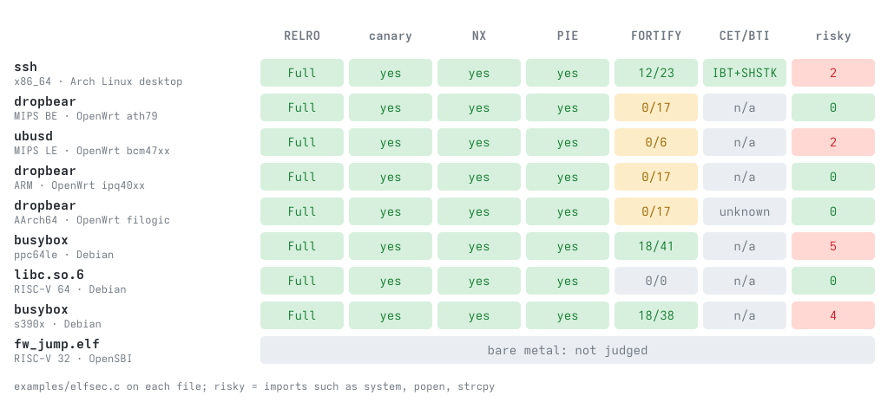

# elfsec

<picture>
  <source media="(prefers-color-scheme: dark)" srcset="docs/images/matrix-dark.svg">
  
</picture>

checksec, as a C library. Give it an ELF image in memory and it says which build and link
protections the image carries (stack protector, non-executable stack, PIE, RELRO, FORTIFY, Intel
CET, AArch64 BTI, PAC and GCS), what it imports, what it needs to run (interpreter,
`DT_NEEDED`, soname, `RPATH`/`RUNPATH`), and which record of the file each answer came from.
Scanners, package managers, CI jobs and firmware tools call it directly, with no script and no
child process.

Version 0.5, MIT licensed, C99 with no dependencies.

## At a glance

[`examples/elfsec.c`](examples/elfsec.c) prints one checksec-style line per file and then what
weakens it:

```console
$ ./elfsec_example /usr/bin/ssh fw_jump.elf
RELRO          STACK CANARY  NX           PIE          FORTIFY       FORT    MACHINE    KIND            FILE
Full RELRO     Canary found  NX enabled   PIE enabled  Fortified      12/23  x86_64     pie             /usr/bin/ssh
  CET: IBT yes, SHSTK yes
  imports popen (shell command)
  imports system (shell command)
N/A            N/A           N/A          N/A          N/A             0/0   riscv      bare metal      fw_jump.elf
```

The same from C:

```c
elfs_elf_t *elf;
elfs_profile_t p;

if (elfs_open(data, len, NULL, NULL, NULL, &elf) == ELFS_OK && elfs_profile(elf, &p) == ELFS_OK) {
    if (p.judged && p.canary == ELFS_NO)
        printf("no stack protector (%s)\n", elfs_kind_name(p.kind));
}
elfs_destroy(elf);
```

- ELF32 and ELF64, either byte order, with or without section headers: an `sstrip`ped binary
  gets the same answer from its segments and dynamic table
- kernels, kernel modules, boot loaders, bare-metal firmware, object files and core dumps are
  recognised and left unjudged; only userland programs and libraries get a verdict
- the image is untrusted: offsets and counts are checked against the buffer and the work per
  image is bounded, and damage or a reached bound is a warning in the profile, not an error
- at most two allocations, and the image is never copied

## Embedding it

```sh
cmake -S . -B build -DBUILD_SHARED_LIBS=ON
cmake --build build
cmake --install build --prefix /usr/local
```

`find_package(elfsec REQUIRED)` and `elfsec::elfsec`, or `cc app.c $(pkg-config --cflags --libs
elfsec)`. Without a build step, `scripts/amalgamate.sh` writes `dist/elfsec/elfsec.h`; one `.c`
file defines `ELFS_IMPLEMENTATION` before including it, and `ELFS_STATIC` keeps the functions
private to that file.

The API reference is [`include/elfsec/elfsec.h`](include/elfsec/elfsec.h). Every call that can
fail returns `ELFS_OK` or a code `elfs_strerror` describes. `elfs_open` fails only on an unusable
file header, and `elfs_destroy` accepts `NULL`. The buffer must outlive the handle, because
returned strings point into it as pointer and length, without a NUL. Pass an allocator to
`elfs_open`, or `NULL` for `malloc` and `free`.

## How each answer is decided

Each protection is `ELFS_YES`, `ELFS_NO`, `ELFS_UNKNOWN` (the image does not say, or the part
that says it cannot be read) or `ELFS_NA` (the image is not judged). Every answer carries an
evidence record: the table it came from (segment, section, dynamic entry, symbol, note, header or
architecture), the record number and its file offset.

| field | yes when |
|---|---|
| `canary` | `__stack_chk_fail`, `__stack_chk_fail_local` or `__stack_chk_guard` is imported; for a static program, named in `.symtab` (no `.symtab`: unknown) |
| `nx` | `PT_GNU_STACK` without `PF_X`; without that segment, yes on AArch64 and RISC-V, where Linux never makes the stack executable, and no elsewhere |
| `pie` | the kind is PIE |
| `relro` | none, partial (`PT_GNU_RELRO`) or full (`PT_GNU_RELRO` and `DT_BIND_NOW`, `DF_BIND_NOW` or `DF_1_NOW`) |
| `fortify` | at least one `_chk` function other than the canary symbols is imported (static: defined); `fortified` counts them and `fortifiable` adds the imports that have a `_chk` form in glibc 2.43 (85 names; `__fdelt_chk` is left out, it backs `FD_SET`) |
| `static_linked` | an executable without `PT_INTERP` |
| `stripped` | no `.symtab` section |
| `ibt`, `shstk` | x86: the GNU property note sets IBT or SHSTK in `GNU_PROPERTY_X86_FEATURE_1_AND` (Intel CET) |
| `bti`, `pac`, `gcs` | AArch64: the GNU property note sets BTI, PAC or GCS (guarded control stack) in `GNU_PROPERTY_AARCH64_FEATURE_1_AND` |

The linker keeps a feature bit only when every object it linked declared it, so a property note
without the bit is a no; without a property note (`.note.gnu.property`, in `PT_GNU_PROPERTY` or a
`PT_NOTE`) the answer is unknown. On other architectures these are `ELFS_NA`. `tests/vectors` holds
shared objects built by gcc and clang with and without `-fcf-protection` and `-mbranch-protection`
(`scripts/vectors.sh`); the tests check each answer against them.

### Classification

| kind | rule, in this order |
|---|---|
| core | `ET_CORE` |
| kernel module | `ET_REL` with `.modinfo` or `.gnu.linkonce.this_module` |
| relocatable | any other `ET_REL` |
| kernel | no interpreter, and a `__ksymtab`, `__ksymtab_strings` or `__ex_table` section or a note named `Linux` (vmlinux, and the vDSO built with it) |
| bare metal | no interpreter, no `DT_NEEDED`, no soname, and one of: a `__u_boot_list` section (U-Boot); no `PT_GNU_STACK` and at most one `PT_LOAD` or an entry in the upper half of the address space; none of the segments only a userland toolchain writes (`PT_PHDR`, `PT_TLS`, `PT_NOTE`, `PT_GNU_RELRO`, `PT_GNU_EH_FRAME`, `PT_GNU_PROPERTY`) |
| PIE | `ET_DYN` with `DF_1_PIE`, or with an interpreter and no soname |
| shared library | any other `ET_DYN` |
| executable | `ET_EXEC` |

Only executables, PIEs and shared libraries are judged. A program packed by UPX or a similar
packer is judged on the stub the packer wrote, not on the program inside.

### Dangerous imports

| class | functions | source |
|---|---|---|
| unbounded write | `gets`, `strcpy`, `strcat`, `sprintf`, `vsprintf`, `wcscpy`, `wcscat` | Microsoft SDL `banned.h`; flawfinder |
| shell command | `system`, `popen` | flawfinder |
| predictable temporary file | `mktemp`, `tmpnam`, `tempnam` | flawfinder |

The table says what a binary calls, not that it is vulnerable.

### Search paths

Each `RPATH`/`RUNPATH` entry is reported with flags: relative to the working directory, empty
(which also means the working directory), or under `/tmp`, `/var/tmp` or `/dev/shm`, any of which
lets another user plant a library. Entries starting with `$ORIGIN` are flagged but not condemned.

## Bounds

Per image the library reads at most 100 000 symbols per symbol table, 8 MiB of names, 4096
program headers, 65 536 section headers, 16 384 dynamic entries, 1024 notes and 1024 search path
entries (`ELFS_MAX_*`). Reaching one sets a warning bit and stops that part of the reading; the
profile is still returned. Of 12 819 ELF files checked (this machine's `/usr/bin` and `/usr/lib`
plus OpenWrt and Debian images for seven architectures), seven large Go programs reach the symbol
and name bounds, with the same profile as readelf and checksec give; nothing else reaches any.

Memory: a handle of under 1 KiB and one list of at most 873 728 bytes, both from the allocator
passed to `elfs_open`.

## Accuracy

The answers are compared with other tools, and every disagreement has a named cause:

- `tests/oracle/readelf_oracle.py` and `sstrip_oracle.py`: segments, dynamic table and symbols as
  readelf sees them, with and without section headers
- `tests/oracle/checksec_oracle.py`: the verdicts of checksec, file by file
- `tests/oracle/fwtriage_oracle.py`: parity with the hardening analyzer of fwtriage
- `tests/vectors`: shared objects built by gcc and clang with and without CET and BTI/PAC flags

`bench/throughput.c` measures a median of 6 us per file of `/usr/bin`, and
`bench/adversarial.c` feeds images built to make every loop as long as possible.

## Building and testing

```sh
cmake --preset dev && cmake --build build/dev && ctest --preset dev
```

CI adds MSVC, a big-endian build under QEMU, a 32-bit build, the oracles, the ABI check and the
fuzzer. Releases follow Semantic Versioning and the soname moves with the major version; the
[CHANGELOG](CHANGELOG.md) lists each one. A verdict that looks wrong is an issue; a crash or an
out-of-bounds read goes through [SECURITY.md](SECURITY.md).
